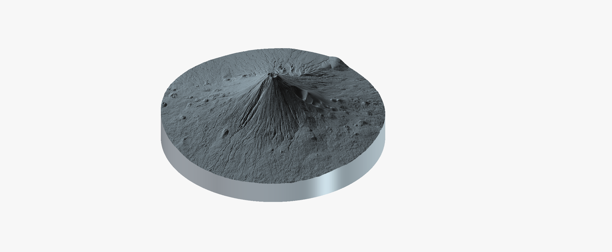
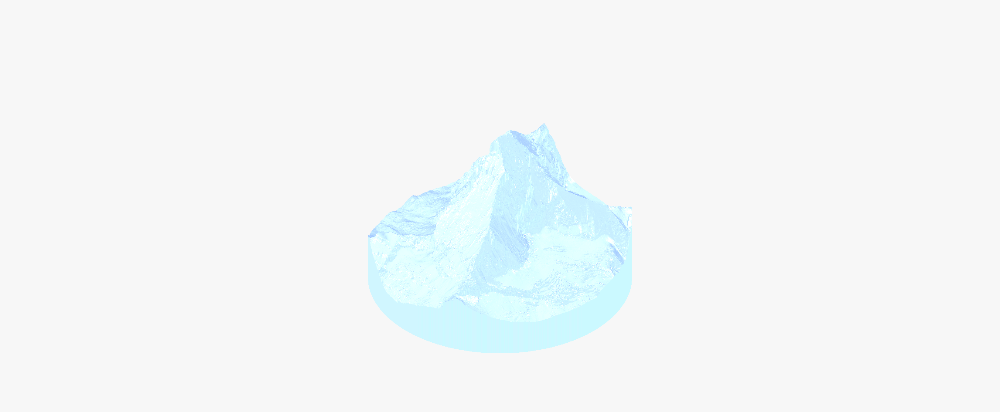

# dem-to-stl

*[English version](README.md)*

Découpe un modèle numérique de terrain (DEM/MNT, GeoTIFF projeté en
mètres) selon un cercle, et exporte un maillage **STL solide et
étanche** (relief + paroi verticale + fond plat), prêt pour
l'impression 3D ou l'usinage CNC — sans trou, sans paroi non-manifold,
échelle physique précise.

## Origine du projet

Ce dépôt est le fruit d'une longue conversation entre un amateur de
travail du bois et de CNC (aucune formation en géomatique ni en
développement logiciel) et Claude (Anthropic), pour produire des
reliefs imprimables à partir de vraies données topographiques du monde
entier — le Mont Fuji, l'Everest, Monument Valley, La Réunion, le
Cervin, entre autres.

**La quasi-totalité du code a été écrite par l'IA sous la direction et
la validation d'un humain** : chaque fonctionnalité est née d'un besoin
concret rencontré en cours de route (un maillage percé, des parois trop
fines pour l'impression, des artefacts de données en pleine mer...),
implémentée par Claude, puis testée sur des données réelles avant
d'être acceptée. Les corrections les moins évidentes (pincement
diagonal, séparation terre/mer par composante connexe plutôt que par
seuil d'altitude) sont documentées ci-dessous et dans les commentaires
du code, précisément parce qu'elles ne sont pas intuitives et qu'on ne
les découvre qu'en pratique.

Aucune garantie de qualité "production" au sens habituel du terme —
c'est un outil de passionné, testé sur des dizaines de cas réels par
un seul utilisateur, pas audité par une communauté. Les retours,
corrections et *pull requests* sont bienvenus.

## Fonctionnalités

- Découpe circulaire d'un DEM autour d'un centre (X, Y) et d'un rayon,
  avec mise à l'échelle physique précise vers un diamètre imprimé cible.
- Polygones réguliers (3 à 360 côtés) inscrits ou circonscrits à un cercle de référence, à angles vifs
  ou arrondis par raccordements tangents exacts (`--sides`, voir plus bas).
- Maillage garanti étanche (vérifié : chaque arête partagée par
  exactement 2 triangles) et normales cohérentes (volume signé positif).
- Élimination automatique des parois trop fines pour l'impression FDM
  (ouverture morphologique) et des pincements en diagonale
  (sommets non-manifold invisibles à un simple test d'étanchéité).
- **Mode île** (`--sea-level`) : pour un DEM où la donnée en mer est
  absente ou aberrante (cas fréquent des LiDAR topographiques), les
  pixels invalides sont remplacés par un plat au niveau de la mer
  plutôt qu'exclus — le relief réel émerge d'un disque toujours plein.
  Sépare la vraie terre du bruit de surface d'eau (vagues classées par
  erreur comme "sol") par composante connexe **et** seuil d'altitude —
  la connectivité seule ne suffit pas quand ce bruit touche le vrai
  littoral.
- Barres de progression (natives GDAL pour le ré-échantillonnage,
  maison pour les boucles Python pures) — utile sur les gros volumes
  (La Réunion : ~40 Go de tuiles sources).
- Diamètre et épaisseur de socle demandés interactivement si omis en
  ligne de commande.

## Galerie

<table>
<tr>
<td></td>
<td></td>
</tr>
<tr>
<td align="center">Mont Fuji — cratère sommital</td>
<td align="center">Cervin</td>
</tr>
</table>

D'autres angles pour chaque site sont disponibles dans [`screenshots/`](screenshots/).

## Installation

```bash
pip install -r requirements.txt
```

GDAL nécessite les bibliothèques système correspondantes (`libgdal-dev`
sur Debian/Ubuntu, `gdal` sur Arch) — si `pip install gdal` échoue,
installe GDAL via le gestionnaire de paquets de ton système plutôt que
pip seul.

**Dépendances optionnelles** (`requirements-optional.txt`) : `laspy` pour les nuages de points LAS
et `lazrs` pour les `.laz` compressés ; `netCDF4` et `h5py` ne servent qu'aux tests. Sans elles,
tout le reste fonctionne, et le programme dit ce qui manque quand tu lui donnes un `.las`/`.laz`.
Sur Arch (où `pip` refuse de toucher à l'environnement système), utilise un environnement virtuel
qui voit quand même le GDAL du système :

```fish
python -m venv --system-site-packages .venv
source .venv/bin/activate.fish
pip install -r requirements.txt -r requirements-optional.txt
```

(Les noms de paquets Arch de laspy/lazrs n'ont pas été vérifiés ici ; `pip` dans un venv est la voie
qui a été testée.)

Un tutoriel complet, pas à pas — de la prise en main rapide sans
téléchargement jusqu'au traitement d'un vrai relief — est disponible
dans [TUTORIAL.md](TUTORIAL.md).

## Usage

```bash
python circle_dem_to_stl.py \
    --input mont_fuji_dem1a.tif \
    --output fuji_disc.stl \
    --cx 293526 --cy 3915399 --radius 9300 \
    --diameter-mm 250 --vexag 1.0
```

Ou directement en coordonnées géographiques (WGS84), que la source soit
déjà projetée ou non — si elle est en CRS géographique, une zone UTM
est déterminée et appliquée automatiquement, sans reprojection manuelle
préalable :

```bash
python circle_dem_to_stl.py \
    --input copernicus_glo30.tif \
    --output relief_disc.stl \
    --lat 35.3606 --lon 138.7274 --radius 9300 \
    --diameter-mm 250 --vexag 1.0
```

### Téléchargement Copernicus DEM intégré

Pas de fichier source sous la main ? `--download-copernicus` récupère
automatiquement les tuiles GLO-30 (30 m, par défaut) ou GLO-90 (90 m)
nécessaires depuis le compartiment S3 public de Copernicus DEM (accès
direct, sans compte ni clé API) :

```bash
python circle_dem_to_stl.py \
    --download-copernicus --cache-dir ./cache \
    --lat 35.3606 --lon 138.7274 --radius 9300 \
    --output relief_disc.stl --diameter-mm 250 --vexag 1.0
```

Les tuiles sont mises en cache dans `--cache-dir` (une par degré carré,
réutilisées d'un lancement à l'autre) et assemblées automatiquement en
mosaïque. Requiert `--lat`/`--lon` (pas `--cx`/`--cy`, puisqu'il faut
des coordonnées géographiques pour déterminer les tuiles). Les tuiles
purement océaniques (absentes du compartiment par convention) sont
ignorées sans faire échouer le téléchargement.

Sans `--diameter-mm`, `--base-mm` ni `--vexag`, le script les demande de
façon interactive au lancement.

### Exagération non linéaire (`--vexag-curve`)

```bash
python circle_dem_to_stl.py --source auto --lat 27.9881 --lon 86.925 --radius 20000 \
    --diameter-mm 200 --vexag-curve "0:0,4000:4000,8848:6000"
```

Au lieu d'un facteur unique, une table *altitude réelle → altitude équivalente* (mètres, point décimal),
appliquée avant l'échelle et `--vexag` (qui multiplie toujours). Dans l'exemple, le relief est à l'échelle
vraie jusqu'à 4000 m, puis les 4848 m suivants ne comptent que pour 2000 m. L'interpolation est une PCHIP
monotone : aucun creux ni pic n'est inventé entre deux points, le point le plus haut reste le plus haut, et au-delà
des points donnés la pente du premier ou du dernier tronçon se prolonge. Deux altitudes équivalentes égales
écrêtent le relief (un plat). Le journal avertit que la pièce n'est **pas une réplique fidèle** (les hauteurs
relatives sont modifiées) et affiche l'exagération moyenne par tronçon ; le nom du fichier reçoit le suffixe
`_courbe`. Avec une courbe, `check_stl.py --relief-m` doit recevoir le relief *équivalent*
(`relief.relief_equivalent_m` dans le JSON de `--report`).

### Mode île (relief entouré d'eau sans donnée fiable)

```bash
python circle_dem_to_stl.py \
    --input reunion_mosaic.vrt \
    --output reunion_disc.stl \
    --cx 347000 --cy 7664000 --radius 38000 \
    --diameter-mm 250 --vexag 3.0 \
    --sea-level 0
```

### Toutes les options

| Option | Description | Défaut |
|---|---|---|
| `--input` | Un ou plusieurs fichiers source : GeoTIFF/VRT, ESRI ASCII Grid (`.asc`), SRTM (`.hgt`), GeoPackage raster (`.gpkg`), NetCDF (`.nc`), HDF5 (`.h5`/`.hdf5`, NetCDF-4/CF seulement), nuage de points LAS/LAZ — voir [Formats d'entrée](#formats-dentrée) | requis |
| `--layer` | Table raster GeoPackage, variable NetCDF ou dataset HDF5 à lire (obligatoire si le fichier a plusieurs candidats) | aucun |
| `--band` | Bande à lire : fichier multibande, ou tranche NetCDF/HDF5 (temps, niveau...) — jamais choisie à ta place | aucun |
| `--source-crs` | CRS d'un fichier qui n'en déclare aucun (p. ex. `EPSG:2056`) ; refusé si le fichier en déclare déjà un | aucun |
| `--vertical-unit` | `m`, `ft` ou `us-ft` : unité des altitudes, remplace celle déclarée (ou absente) | unité déclarée, sinon mètres + avertissement |
| `--lidar-select` | LAS/LAZ : `ground` (moyenne des points de classe 2 par cellule), `lowest` ou `highest` par cellule | `ground` |
| `--lidar-cell` | LAS/LAZ : taille de cellule de la grille du nuage, en m | pixel de travail |
| `--lidar-interp` | LAS/LAZ : comblement des trous `linear`, `nearest` ou `none` | `linear` |
| `--lidar-max-gap` | LAS/LAZ : distance maximale de comblement, en m | 50 cellules |
| `--lidar-spike-m` | LAS/LAZ : tolérance des cellules isolées pic/puits, en m (`0` = désactivé) | 10 |
| `--output` | Fichier STL de sortie | requis |
| `--cx`, `--cy` | Centre du cercle, dans le CRS du fichier source | voir `--lat`/`--lon` |
| `--lat`, `--lon` | Centre du cercle en WGS84 — alternative à `--cx`/`--cy` | voir `--cx`/`--cy` |
| `--radius` | Rayon du cercle (de référence avec `--sides`), en mètres | requis |
| `--diameter-mm` | Diamètre final imprimé, en mm | demandé si omis (250) |
| `--base-mm` | Épaisseur du socle plat, en mm | demandé si omis (3) |
| `--vexag` | Exagération verticale | demandée si omise (1.0) |
| `--vexag-curve` | Exagération non linéaire : points `alt:équivalente,...` (m), PCHIP, appliquée avant l'échelle et `--vexag` ; pas une réplique fidèle | désactivé |
| `--print-spacing-mm` | Résolution cible du maillage, en mm | 0.2 |
| `--resample` | Ré-échantillonnage du DEM : `auto`, `average`, `bilinear`, `cubic`, `cubicspline` | `auto` |
| `--top` | Triangulation du dessus : `grid`, `adaptive` (prototype) | `grid` |
| `--top-tol-mm` | Avec `--top adaptive` : tolérance verticale, en mm d'impression | 0.05 |
| `--diagonal` | Diagonale de coupe des cellules du dessus : `fixed`, `adaptive` (prototype) | `fixed` |
| `--bottom` | Triangulation du fond plat : `grid`, `merged` (prototype), `merged-rows` (comparaison) | `grid` |
| `--bottom-max-cells` | Avec `merged-rows` : côté maximal d'un rectangle, en cellules (0 = sans limite) | 0 |
| `--sides` | Polygone régulier à N côtés (3-360) au lieu du disque (voir ci-dessous) | désactivé |
| `--circle-mode` | Avec `--sides` : `inscribed` (sommets sur le cercle de référence) ou `circumscribed` (côtés tangents) | requis avec `--sides` |
| `--corner-radius` | Avec `--sides` : rayon d'arrondi des sommets, en mm imprimés | 0 (angles vifs) |
| `--rotation` | Avec `--sides` : rotation en degrés, sens antihoraire | 0 |
| `--corner-tol-mm` | Avec `--sides` et `--corner-radius` : flèche maximale des arcs, en mm imprimés | 0.005 |
| `--corner-segments` | Avec `--sides` et `--corner-radius` : nombre de segments par arc (remplace `--corner-tol-mm`) | calculé |
| `--sea-level` | Active le mode île à cette altitude (m) | désactivé |
| `--min-elevation` | Seuil d'exclusion des gouffres d'interpolation, en m | -50 |
| `--land-threshold` | Seuil terre/bruit d'eau au-dessus de `--sea-level`, en m | 1.0 |
| `--extrapolate-edges` | Prolonge le relief sur 50 pixels de travail au plus au-delà des données (ancien comblement) ; les cellules inventées sont journalisées | désactivé |
| `--download-copernicus` | Télécharge les tuiles Copernicus DEM nécessaires au lieu de fournir `--input` | désactivé |
| `--copernicus-product` | Résolution Copernicus à télécharger : `30` (GLO-30) ou `90` (GLO-90) | 30 |
| `--cache-dir` | Dossier de cache des tuiles Copernicus téléchargées | `./copernicus_cache` |
| `--preview` | Aperçu ombré PNG de la zone découpée, écrit avant le maillage ; nom de fichier facultatif | désactivé |
| `--report` | Rapport JSON à côté du modèle (source, mention de licence, échelle, relief, triangles, ligne de commande) ; nom de fichier facultatif | désactivé |

Fournis soit `--cx`/`--cy`, soit `--lat`/`--lon` — pas les deux.

## Architecture

```
circle_dem_to_stl.py   # argparse, prompts interactifs, orchestration
formats.py             # formats d'entrée : détection, règles de lecture par format, normalisation (CRS, unités, NoData)
lidar.py               # nuages LAS/LAZ : lecture par blocs, filtrage des classes, rastérisation, comblement
raster.py              # GDAL : ouverture, détection/reprojection CRS, ré-échantillonnage
mesh.py                # numpy/scipy pur : nettoyage du masque, construction du maillage
regular_polygon.py     # numpy pur : polygones réguliers (--sides), appartenance exacte, projection, arcs
vexag_curve.py         # exagération non linéaire (--vexag-curve) : altitude -> altitude équivalente, PCHIP monotone
stl_io.py              # écriture STL binaire
preview.py             # aperçu ombré PNG (--preview) : ombrage et écriture du PNG, sans GDAL
report.py              # hauteur de relief imprimé, exagération indicative, rapport JSON (--report) ; sans GDAL
download.py            # téléchargement Copernicus DEM (compartiment S3 public)
tests/
```

Toute source suit la même chaîne : **détection → lecteur → normalisation (altitudes en mètres,
CRS connu, NoData marqué) → traitement géospatial (reprojection, découpe, ré-échantillonnage) →
moteur de maillage commun → export**. Le moteur de maillage (`mesh.py`) ignore tout des formats de
fichiers. Un nuage de points n'est pas forcé dans un lecteur raster : `lidar.py` le rastérise
directement sur la grille de travail.

`mesh.py` ne dépend jamais de GDAL ni du disque — testable avec de
simples tableaux numpy, ce qui permet de vérifier étanchéité et
cohérence des normales sans jamais ouvrir un fichier.

## Formats d'entrée

`--input` accepte un ou plusieurs fichiers ; le format est reconnu par l'extension et, pour les
nuages de points, par la signature du fichier. Quel que soit le format, le programme ne devine
jamais en silence : quand un choix est ambigu (plusieurs bandes, tables ou variables, CRS
absent, nuage non classifié), il **s'arrête et dit quoi ajouter**. Les niveaux ci-dessous sont
ceux qui ont réellement été testés.

| Format | Extensions | Niveau | À savoir |
|---|---|---|---|
| GeoTIFF, VRT | `.tif` `.tiff` `.vrt` | **pleinement pris en charge** | Toutes les compressions de ton GDAL (DEFLATE, LZW, PackBits, tuiles, BigTIFF ; ZSTD et LERC ont été testés car ce GDAL les a). Int16/UInt16/Int32/Float32/Float64. Une bande, ou `--band N`. |
| ESRI ASCII Grid | `.asc` | **pleinement pris en charge** | En-tête validé (fichier mal formé ou tronqué refusé, jamais lu à l'aveugle). CRS lu dans le `.prj` voisin, sinon `--source-crs`. |
| SRTM | `.hgt` | **pleinement pris en charge** | Le nom doit ressembler à `N46E007.hgt` (il porte la position). SRTM1 (3601²) et SRTM3 (1201²). Les vides sont du NoData. Donne les tuiles voisines ensemble pour les assembler. |
| GeoPackage (raster) | `.gpkg` | **avec sélection** | Uniquement des **tables raster d'altitudes** (une bande Int16/UInt16/Float32). À partir de 2 tables, `--layer TABLE` est obligatoire. Les GeoPackage vectoriels seuls et les tuiles image (RVB, palette) sont refusés : *tout GeoPackage n'est pas un MNT*. |
| NetCDF | `.nc` | **avec sélection** | Axes spatiaux réguliers (lat/lon ou x/y) requis. Plusieurs variables → `--layer NOM`, sauf si une seule se déclare altitude. Dimensions supplémentaires (temps, niveau) → `--band N`. |
| HDF5 | `.h5` `.hdf5` | **partiel** | Seulement le HDF5 qui suit le modèle NetCDF-4/CF avec axes spatiaux (lu comme un NetCDF). Un HDF5 générique (datasets bruts) est **signalé comme non pris en charge**, avec la liste de ses datasets. |
| LAS, LAZ | `.las` `.laz` | **pris en charge, chaîne propre** | Requiert `laspy` (+`lazrs` pour les `.laz`). Classe sol 2 par défaut ; un nuage non classifié exige un `--lidar-select` explicite. Voir [Nuages de points](#nuages-de-points-lasllaz). |
| XYZ texte, **grille régulière** | `.xyz` | **pris en charge** (GDAL « ASCII Gridded XYZ ») | Une ligne `x y z` par cellule d'une grille régulière, lignes dans l'un ou l'autre sens ; un point ou une ligne absent est du NoData (jamais zéro ; une altitude réelle de 0,000 m reste une valeur). Le fichier ne porte pas de CRS : `--source-crs` est obligatoire. Une liste de points dispersés n'est **pas** une grille et est refusée (« Ungridded dataset »). |
| Tout autre raster ouvert par GDAL | | lu via GDAL (pas testé spécifiquement) | Mêmes règles de bandes, CRS, unités et NoData. |
| **Non pris en charge** | archives `.zip`/`.hgt.zip`, nuages E57/PLY, listes de points XYZ dispersés, grilles NetCDF curvilignes ou irrégulières, HDF5 générique | refusé avec un message | Décompresse / convertis d'abord (`gdal_translate`, PDAL). |

### Règles communes à tous les formats

* **Les altitudes sont converties en mètres** d'après l'unité déclarée (`feet`, `US survey
  foot`, `cm`, `km`...). On utilise l'unité de la bande, de la variable NetCDF ou de la partie
  verticale d'un CRS composé ; `--vertical-unit m|ft|us-ft` la remplace. Si rien n'est déclaré,
  **les mètres sont supposés et un avertissement le dit** ; une unité qui n'est pas une
  longueur (p. ex. `K`) est refusée. Un `scale`/`offset` déclaré (entiers empaquetés) est
  appliqué ; un `positive = down` NetCDF (profondeurs) inverse le signe.
* **Les coordonnées ne sont jamais supposées.** Un fichier sans CRS est refusé tant que tu ne
  donnes pas `--source-crs EPSG:xxxx` (lui-même refusé si le fichier déclare déjà un CRS).
  Degrés et mètres sont vérifiés contre l'emprise (un CRS « géographique » avec des
  coordonnées de 2 600 000 est refusé ; un CRS métrique avec des coordonnées de la taille de
  degrés déclenche un avertissement). Un NetCDF à axes `degrees_north/east` sans datum est lu en
  WGS84 **avec un avertissement explicite**. Une source en pieds est reprojetée en mètres
  (UTM) ; `--radius` est toujours en mètres.
* **Aucun changement silencieux de datum vertical.** Un CRS composé (p. ex. EPSG:2056+5728)
  voit sa partie verticale ignorée pour le positionnement, et le journal dit qu'aucune
  conversion géoïde/ellipsoïde n'a été faite.
* **Le NoData n'est jamais zéro, et le relief n'est pas prolongé au-delà des données.** NoData
  déclaré, NaN/inf, vides SRTM et zone hors de l'emprise du fichier restent du NoData. Seuls les
  trous sont comblés (le nombre de cellules comblées est journalisé) : zones entourées de données
  ou qui traversent la fenêtre de part en part (rivière, joint entre deux dalles), à 50 pixels au
  plus d'une donnée. Tout le reste est exclu du modèle : la zone au-delà du bord du fichier, la mer
  d'une source qui la laisse vide, toute zone plus grande. Voir
  [Trous et bord des données](#trous-et-bord-des-données). Les sources entières sont
  ré-échantillonnées en virgule flottante.
* **Aucun sous-échantillonnage silencieux**, et le journal affiche une ligne `entrée ...` par
  fichier : format, taille, type, CRS, unité, et quelle bande/variable/couche a été choisie.

### Exemples

```bash
# GeoTIFF multibande : choisir la bande
python circle_dem_to_stl.py --input mnt.tif --band 2 --cx 2601000 --cy 1201000 --radius 300 --diameter-mm 60 --vexag 1 --output out.stl
# Altitudes en pieds non déclarées par le fichier
python circle_dem_to_stl.py --input mnt.tif --vertical-unit ft ...
# ASC sans .prj
python circle_dem_to_stl.py --input terrain.asc --source-crs EPSG:2056 ...
# SRTM : deux tuiles voisines assemblées, centre sur la couture
python circle_dem_to_stl.py --input N46E007.hgt N46E008.hgt --lat 46.5 --lon 8.0 --radius 3000 ...
# GeoPackage à plusieurs tables raster
python circle_dem_to_stl.py --input donnees.gpkg --layer mnt_2m ...
# NetCDF : variable et pas de temps
python circle_dem_to_stl.py --input grille.nc --layer elevation --band 3 --lat 46.1 --lon 7.15 --radius 3000 ...
```

### Nuages de points (LAS/LAZ)

Un nuage de points n'a ni grille, ni NoData, ni résolution native : il n'est **pas** forcé dans
un lecteur raster. `lidar.py` le lit par blocs de 2 millions de points (mémoire constante) et le
rastérise **directement sur la grille de travail** (même origine, même pas, même CRS), sans
ré-échantillonnage supplémentaire sauf si tu demandes `--lidar-cell`.

1. Les points hors de la fenêtre demandée sont écartés d'abord ; le CRS du fichier (enregistrement
   WKT, enregistrement étendu, ou clés GeoTIFF) est reprojeté bloc par bloc s'il diffère du CRS de travail.
2. Les points *withheld* et les classes de bruit ASPRS 7 et 18 sont toujours exclus. Avec
   `--lidar-select ground` (défaut), seule la classe 2 est gardée et chaque cellule prend la
   **moyenne** de ses points sol ; `lowest`/`highest` prennent le min/max de tous les points
   gardés. Un nuage **non classifié** avec `ground` est refusé, avec les classes présentes et
   les alternatives ; `lowest` n'est qu'une approximation du sol (trop haut sous canopée dense
   ou bâti) et le journal le dit.
3. Les doublons exacts (mêmes x, y, z) sont retirés dans chaque bloc.
4. Les cellules isolées aberrantes (pic ou puits dépassant toutes leurs ≥5 voisines valides de
   plus de `--lidar-spike-m` plus leur propre étendue) sont écartées ; les pentes et falaises ne le sont pas.
5. Les cellules vides sont comblées selon `--lidar-interp` : `linear` (triangulation de
   Delaunay des cellules valides autour des trous ; jamais d'extrapolation hors du nuage),
   `nearest`, ou `none` ; seulement jusqu'à `--lidar-max-gap` (défaut 50 cellules). Le journal
   dit combien de cellules ont été comblées et combien restent sans donnée, et avertit quand moins
   de la moitié des cellules contient un point (le détail comblé serait inventé).
6. `--lidar-cell M` (défaut : le pixel de travail) fixe la cellule de la grille du nuage ; si elle
   diffère du pixel de travail, la grille est ré-échantillonnée **une seule fois** (bilinéaire si
   plus grossière, moyenne si plus fine) et le journal le dit.

L'unité d'altitude vient de l'unité verticale du CRS (ou de `--vertical-unit`) ; à défaut, l'unité
horizontale est supposée, **avec un avertissement**. Un nuage sans CRS exige `--source-crs`.
Plusieurs fichiers doivent partager un même CRS. Testé sur LAS 1.2/1.3/1.4 (formats de points 0, 1,
3, 4, 6, 8) et LAZ.

### Erreurs fréquentes et remèdes

| Message (début) | Cause | Remède |
|---|---|---|
| `... contient N bandes ... --band N` | fichier multibande ou dimension temps NetCDF/HDF5 | choisis la bande (la liste donne le temps/l'unité de chacune) |
| `... aucun système de coordonnées ... --source-crs` | pas de CRS dans le fichier | `--source-crs EPSG:xxxx` |
| `... déclare déjà un CRS` | `--source-crs` donné pour un fichier géoréférencé | retire `--source-crs` |
| `... impossible en degrés` | CRS géographique déclaré pour des coordonnées en mètres | corrige le CRS du fichier ou donne le bon `--source-crs` |
| `... n'est pas une unité de longueur` | variable en K, %, ... | ce n'est pas une altitude ; ou force `--vertical-unit` si c'en est une |
| `fichier ASC tronqué` / `en-tête ASC mal formé` | `.asc` coupé ou mal formé | re-télécharge / régénère le fichier |
| `tuile SRTM ... le nom doit être ...` | `.hgt` renommé ou dans une archive | rétablis un nom du type `N46E007.hgt`, décompresse |
| `... N tables raster, choisis-en une avec --layer` | plusieurs tables raster | `--layer TABLE` |
| `... ne se déclare pas comme une altitude ... --layer` | variable(s) NetCDF non identifiée(s) comme altitude | `--layer NOM` si tu sais que c'en est une |
| `HDF5 non géoréférencé` | HDF5 générique sans axes | convertis d'abord en GeoTIFF/NetCDF avec `gdal_translate` |
| `aucun point classé « sol »` | nuage non classifié | classe-le (PDAL `filters.smrf`, LAStools `lasground`) ou `--lidar-select lowest`/`highest` |
| `la lecture des fichiers LAS/LAZ requiert laspy` / `compressé (LAZ) ... aucun décompresseur` | dépendance optionnelle absente | `pip install laspy lazrs` (dans un venv) |
| `aucun point du nuage dans la zone demandée` | centre/rayon hors du nuage | vérifie `--cx/--cy` et le CRS du nuage |

### Limites connues

* HDF5 : seulement la structure NetCDF-4/CF ; pas de HDF5 générique, pas de HDF-EOS.
* NetCDF : une variable et une tranche par exécution ; pas de grilles curvilignes ou irrégulières.
* GeoPackage : tables raster d'altitudes uniquement. GDAL applique l'échelle/décalage et la
  précision déclarés par la table : lors de notre test, une table déclarant une précision de 1
  a rendu des valeurs arrondies au mètre (c'est GDAL qui lit le fichier tel que déclaré).
* SRTM : fichiers `.hgt` uniquement (pas de `.zip`) ; des tuiles SRTM1 et SRTM3 ne sont pas mélangées dans un assemblage (avertissement).
* Le datum vertical (géoïde ou ellipsoïde) n'est jamais converti ; une unité non déclarée est supposée en mètres.
* LAS/LAZ : le fichier entier est lu une fois en flux (le temps croît avec le nombre de points,
  pas avec la taille de la fenêtre) ; les doublons exacts ne sont retirés qu'au sein d'un bloc de
  2 millions de points ; `lowest` approxime le sol ; le comblement `linear` peut enjamber une
  concavité à l'intérieur de l'enveloppe convexe des cellules voisines.
* Comportement antérieur désormais journalisé : `--min-elevation` (défaut −50 m) écartait
  auparavant en silence les terrains plus bas ; le nombre de cellules exclues est maintenant affiché.


## Sources de données compatibles

Testé avec succès sur, entre autres : GSI DEM1A (Japon, XML/JPGIS —
nécessite un pré-traitement, non inclus ici), IGN LiDAR HD (France),
USGS 3DEP (États-Unis), swissALTI3D (Suisse), Kartverket LiDAR
(Norvège), Copernicus GLO-30 (mondial). Le CRS géographique ou projeté
est détecté automatiquement (`gdalinfo` reste utile pour vérifier ce
que contient un fichier avant de s'en servir, mais la reprojection
manuelle préalable n'est plus nécessaire).

## Sources nationales automatiques (`--source`)

Avec `--lat/--lon`, le DEM peut être récupéré automatiquement au lieu de
fournir `--input` :

```
python circle_dem_to_stl.py --source auto --lat 46.0 --lon 7.6 --radius 5000 --output out.stl
```

| `--source` | Fournisseur | Méthode d'accès |
|---|---|---|
| `swisstopo` | swissALTI3D (Suisse) | API STAC, tuiles GeoTIFF 0,5 m / 2 m |
| `kartverket` | Høydedata DTM1 (Norvège) | WCS, ré-échantillonné à la résolution de travail |
| `usgs` | 3DEP (États-Unis) | API TNM Access, lecture partielle via `/vsicurl/` |
| `gsi` | Tuiles d'élévation GSI (Japon) | tuiles PNG (DEM1A → DEM5A/5B → DEM10B), Web Mercator |
| `ign` | MNT LiDAR HD 0,5 m, repli RGE ALTI 1 m (France, La Réunion) | WMS-R, GeoTIFF flottant brut ; les images rendues/estompées sont rejetées |
| `austria` | MNT laser aéroporté 1 m du BEV (Autriche) | flux ATOM INSPIRE, dalles Cloud-Optimized GeoTIFF de 50 km (EPSG:3035), lecture partielle via `/vsicurl/` ; **explicite seulement** : `auto` ne l'essaie jamais |
| `copernicus` | GLO-30/90 (monde) | identique à `--download-copernicus` |
| `auto` | source nationale couvrant le point, sinon Copernicus | — |

La résolution récupérée suit la résolution de travail (déduite de
`--diameter-mm`, `--radius` et `--print-spacing-mm`) : pas de 1 m
téléchargé quand une grille de 15 m suffit. Les données sont mises en
cache dans `--cache-dir`.

**État.** Ces fournisseurs ont été écrits d'après la documentation
officielle mais n'ont pas pu être testés sur les serveurs réels dans
l'environnement de développement (les tests utilisent du HTTP simulé).
Les noms de jeux de données USGS et le nom de couverture Kartverket en
particulier sont à confirmer au premier usage réel. Kartverket et IGN (serveurs WCS/WMS dont la syntaxe exacte n'a pas pu être confirmée) essaient plusieurs variantes de requête et journalisent celle acceptée ; la couverture LiDAR HD de la France est encore incomplète (un avertissement indique la part du disque sans donnée). Le téléchargement XML FGD de
GSI exige un compte et n'est pas automatisé ; le service de tuiles est
utilisé à la place (valeurs interpolées, pas le maillage JPGIS brut).

`austria` (BEV) : la licence (CC BY 4.0), la résolution de 1 m et le service de
téléchargement ATOM viennent de la fiche officielle du fournisseur ; l'adresse du
flux, la forme des titres de ses entrées et l'idée que les COG déclarent un CRS
inutilisable viennent du projet libre `geostl`. Or les deux dalles examinées
(E = 4 500 000 et 4 550 000 m) déclarent un CRS correct (« ETRS89-extended / LAEA
Europe », EPSG:3035, lu avec GDAL 3.13.3) : le petit VRT local dont l'outil enveloppe
chaque dalle, et qui impose EPSG:3035, n'est donc probablement pas indispensable ; il
est conservé par précaution. **Essayée sur le vrai serveur du BEV à deux endroits seulement**
(octobre 2026, série du 15.09.2025, tous deux en haute montagne) : le Grossglockner
(une dalle) et une zone à cheval sur la limite de deux dalles (E = 4 550 000 m,
raccord vertical) ; dans les deux cas le STL est étanche (`check_stl.py`) et le raccord
est invisible sur l'aperçu. Pas encore essayés : une plaine de l'est, le Vorarlberg,
une jonction de quatre dalles, un rayon de plusieurs dizaines de km. C'est pourquoi la
source n'est pas dans `auto` : ailleurs, essaie d'abord `--source austria` et signale
tout échec. Chaque dalle fait 50 km de côté et n'est jamais téléchargée en entier. Le CRS de travail est celui de la source (EPSG:3035) ;
sa distorsion d'échelle sur l'Autriche est d'au plus 0,08 % environ (mesurée en six
points avec GDAL 3.8.4), soit 0,15 mm sur un modèle de 200 mm. La précision en
hauteur du BEV est en général de ±0,5 m, davantage en haute montagne (fiche du
fournisseur).

### Noms de lieux (`--place`)

À la place des coordonnées, tu peux donner un nom de lieu ; il est résolu avec
Nominatim (OpenStreetMap) et, sans `--input` ni `--source`, la source de DEM est
choisie automatiquement :

```
python circle_dem_to_stl.py --place "Mont Fuji" --radius 9300 --diameter-mm 250 --output fuji.stl
```

Le premier résultat (ordre de pertinence de Nominatim) est utilisé ; les autres
candidats sont listés dans le log et `--place-pick N` en choisit un autre. Une
zone administrative ou une île se résout à son centre, pas à un sommet : le log
l'indique, et `--lat/--lon` reste disponible pour un point exact. Le serveur
public Nominatim limite à 1 requête par seconde et attend un User-Agent
identifiant (surcharge avec `DEM2STL_USER_AGENT`, idéalement avec un contact) ;
les résultats sont mis en cache dans `--cache-dir`. Données de géocodage
© contributeurs OpenStreetMap (ODbL).

### Résolution et qualité des sources automatiques

Le maillage est limité par `--print-spacing-mm` : le DEM est ré-échantillonné
(`average` quand la grille de travail est plus grossière que la source, voir `--resample`
ci-dessous) à `print-spacing / échelle` mètres par pixel (affiché comme « résolution
de ré-échantillonnage » dans le log, par ex. 8 m pour une impression de 150 mm d'un
rayon de 3 km). Les sources ne récupèrent donc que la résolution utile à cette grille
(swisstopo 2 m au lieu de 0,5 m, tuiles GSI au zoom correspondant, requêtes WCS/WMS à
2x la résolution de travail), d'où des fichiers en cache bien plus légers que des
téléchargements en pleine résolution. Moyenner du 0,5 m ou du 2 m jusqu'à 8 m donne
une grille quasi identique.

* `--full-res` récupère la résolution la plus fine de chaque source (téléchargements
  lourds, maillage de même taille). Sans lui, Kartverket et IGN ré-échantillonnent côté
  serveur (plus proche voisin) à 2x la résolution de travail avant de moyenner ;
  `--full-res` supprime ce raccourci.
* `--resample auto` (défaut) utilise `average` quand la grille de travail est plus grossière
  que la source (la moyenne fait de l'anticrénelage) et `bilinear` quand elle est plus fine,
  c'est-à-dire quand le DEM est agrandi (par exemple un DEM mondial de 30 m sur un petit
  rayon, ou le repli Copernicus). Le `average` de GDAL se comporte alors comme le plus
  proche voisin : la surface devient des paliers plats séparés par des marches (dans un
  test synthétique, 25 à 77 % des cellules avaient une pente exactement nulle pour un
  agrandissement de 4x à 16x). Le log indique « ré-échantillonnage bilinear » quand c'est
  le cas. `cubic` peut dépasser près des falaises (environ 7 % de la marche, soit 71 m
  sur une falaise de 1000 m) ; `cubicspline` lisse sans dépasser ; `average` impose
  l'ancien comportement.
* `--top adaptive` (prototype, le défaut reste `grid`) remplace le dessus par un maillage RTIN à
  erreur bornée (réseau irrégulier de triangles rectangles) : très peu de triangles là où le relief
  est lisse, pleine résolution le long du contour et des jonctions de blocs de 1024 cellules, donc
  les parois et le fond sont inchangés et le solide reste étanche. La tolérance est nominale :
  mesurée contre les nœuds du DEM sur quatre relevés réels, l'écart maximal vaut 1,5 à 1,8 fois
  `--top-tol-mm` (pour garantir une erreur maximale donnée, en prendre la moitié). La réduction
  dépend du détail réel que porte la grille de travail : un relevé de 5 m dérivé du LiDAR imprimé à
  250 mm / 0,2 mm passe de 2,5 M à 144 000 triangles à 0,05 mm (−94 %) ; un relief de type bruit ne
  perd presque rien. La mémoire est bornée par la taille des blocs. `--diagonal adaptive` n'a pas
  de sens avec cette option (refusé).
* `--diagonal adaptive` (prototype, le défaut reste `fixed`) coupe chaque cellule du dessus selon la
  diagonale qui relie les deux coins de plus faible écart d'altitude. Même nombre de triangles, mêmes
  sommets, mêmes parois et même fond : seule la surface change. Mesurée au centre des cellules contre
  le DEM lui-même sur six relevés réels (pixels de 5 m à 240 m), l'erreur moyenne baisse de 4 % (pas de
  grille 4) à 7 % (pas 8) par rapport à la diagonale fixe, de 13 à 25 % sur le relevé de 5 m dérivé du
  LiDAR, et monte de 2,5 % au pire (le relevé de 240 m). Au pas par défaut de 0,2 mm la différence est
  très faible ; elle compte pour des pas grossiers par rapport au détail du relief.
* `--bottom merged` (prototype, le défaut reste `grid`) triangule le fond plat avec les carrés d'un
  quadtree équilibré, chacun en éventail gardant tous les nœuds de contour nécessaires : aucune
  jonction en T, le solide reste étanche. La géométrie est identique (même plan, même contour,
  même volume : les tests les comparent à 1e-12) mais le fichier a environ moitié moins de
  triangles (le fond perd 96 à 99 %), un pic de RAM plus bas et une taille réduite. Les triangles
  restent compacts (allongement d'au plus 4 dans les tests). `merged-rows` utilise des rectangles
  gloutons (la méthode du dépôt my3dmaps) : encore moins de triangles, mais extrêmement allongés
  (allongement supérieur à 10^5 mesuré sur un disque), conservé pour comparaison seulement.
  Vérifiez le résultat dans votre trancheur et votre FAO avant d'en faire le défaut.
* Les réponses HTTP 429 et 503 avec un en-tête `Retry-After` (secondes ou date HTTP) sont
  attendues, au moins cette durée, plafonnée à 60 s.
* Les téléchargements sont contrôlés : une réponse tronquée est retentée, et une page
  d'erreur reçue en HTTP 200 (XML/HTML au lieu d'un GeoTIFF ou d'un PNG) n'est ni mise en
  cache ni réutilisée si une exécution précédente l'y avait enregistrée (le fichier
  invalide est retéléchargé).
* Repli de résolution GSI : aux résolutions de travail fines (zoom 16-17), seule la couche DEM1A est
  interrogée. Une tuile qu'elle n'a pas laissait un trou (ou « aucune tuile » pour toute la zone). Elle est maintenant remplacée par les couches suivantes à leur propre
  zoom (DEM5A/5B au zoom 15, puis DEM10B au zoom 14) ; ces mosaïques plus grossières sont transmises
  au ré-échantillonnage, qui les interpole (bilinéaire) sous la mosaïque fine. Le log indique « repli
  de résolution ». Avec plusieurs sources de résolutions différentes, la plus grossière décide du
  choix de `--resample auto`.
* Les tuiles d'élévation GSI sont dérivées du DEM (interpolées, pas de 1 cm), pas le
  maillage JPGIS brut ; leur nombre est plafonné, donc une très grande zone utilise un
  zoom plus grossier.
* `compare_dems.py A B --lat .. --lon .. --radius .. --pixel-size ..` mesure l'écart
  entre deux DEM sur la grille de travail (décalage moyen, RMS, 95e centile), pour
  valider une source automatique contre des données téléchargées à la main.

### Trous et bord des données

Les cellules de la zone sans donnée sont traitées de deux façons :

* **Les trous** (vides, bande manquante entre deux dalles, rivière laissée vide par la source) sont
  comblés par interpolation pondérée par l'inverse de la distance (`gdal.FillNodata`), à condition
  d'être entourés de données ou de traverser la fenêtre de part en part, et qu'aucune cellule ne soit
  à plus de 50 pixels de travail d'une donnée. Le nombre de cellules comblées est journalisé.
* **Tout le reste** reste vide : la zone au-delà du bord du fichier, la mer d'une source qui la laisse
  sans donnée, une grande zone manquante. Un disque coupé par le bord du
  fichier est donc tronqué au lieu d'être complété, ce que `--preview` montre ; avec `--sea-level`,
  ces cellules deviennent de la mer. Le journal compte les cellules de la zone que l'ancien comblement
  aurait prolongées depuis le bord des données.

L'ancien comblement prolongeait le relief sur 50 pixels de travail au-delà des données. Avec
`--print-spacing-mm 0.2` (valeur par défaut), cela fait 10 mm sur la pièce imprimée, quel que soit le
rayon, et c'était du relief inventé : sur une côte à falaise, par exemple, un plateau à la hauteur de la
falaise avançait dans la mer. `--extrapolate-edges` le rétablit (le journal indique alors combien de
cellules ont été extrapolées). Avec `--sides`, une forme qui dépasse les données est refusée, comme
avant ; `--extrapolate-edges` l'accepte quand le dépassement tient dans 50 pixels. L'option est sans
effet sur une entrée LAS/LAZ, qui ne s'étend jamais au-delà des points (voir `--lidar-interp`). Le JSON
de `--report` compte ces cellules dans `source.no_data`.

### Combler les trous avec Copernicus (`--fill-with-copernicus`)

Les sources nationales s'arrêtent à leur frontière (par ex. swissALTI3D côté
italien du Cervin) et certaines sont incomplètes (IGN LiDAR HD). Avec
`--fill-with-copernicus` (requiert `--lat/--lon` ou `--place` ; fonctionne avec
`--source` ou `--input`), les parties du disque sans donnée sont comblées avec
Copernicus GLO-30, téléchargé seulement s'il y a des trous. Copernicus est d'abord
décalé en altitude de la différence médiane mesurée sur la zone couverte par les
deux rasters (journalisée, avec l'écart interquartile) ; le comblement est abandonné
si ce décalage dépasse 50 m. Limites : Copernicus est un modèle de surface (arbres,
bâtiments) à 30 m alors que les données nationales sont en général du sol nu, donc
le raccord montre un changement de résolution et de nature ; le log indique la part
du disque comblée.

### Polygones réguliers (`--sides`)

À la place du disque, un polygone régulier à N côtés (3 à 360) associé à un **cercle de référence**, avec
sommets éventuellement arrondis :

```
python circle_dem_to_stl.py --input mnt.tif --cx 2601000 --cy 1201000 --radius 300 --diameter-mm 60 \
    --base-mm 3 --sides 6 --circle-mode circumscribed --corner-radius 2 --output hexagone.stl
```

* Le cercle de référence est celui de `--radius` (mètres de terrain) et de `--diameter-mm` (son diamètre
  imprimé) : même échelle qu'un disque. `--circle-mode` est obligatoire : `inscribed` (les sommets sont sur le
  cercle) ou `circumscribed` (les côtés sont tangents au cercle). En mode circonscrit la pièce **dépasse**
  `--diameter-mm` (jusqu'à un facteur 1/cos(π/N) sur les sommets) : le journal et `--dry-run` affichent les
  dimensions réellement imprimées (`pièce : L x l mm`).
* `--corner-radius R` arrondit les sommets par des arcs de cercle tangents aux côtés, `R` en **mm imprimés**
  (0 ou omis : angles vifs). Maximum : l'apothème de la pièce ; à cette valeur le contour devient un cercle.
  Le cercle de référence décrit toujours le polygone à angles vifs, même arrondi : la pièce arrondie est donc
  un peu plus petite aux sommets (rayon extrême du contour : (a − R)/cos(π/N) + R, affiché dans le journal).
* Orientation par défaut : un sommet au nord pour N impair, un côté au nord pour N pair. `--rotation` la fait
  tourner de ce nombre de degrés, dans le sens antihoraire.
* Le bord est **exact** : côtés droits (pas d'escalier), sommets et points de tangence sur le contour théorique,
  paroi verticale. Les arcs sont découpés pour que l'écart corde-arc ne dépasse pas `--corner-tol-mm` (défaut
  0,005 mm imprimé ; les sommets sont sur l'arc, les cordes à l'intérieur) ou en `--corner-segments` segments
  par arc si tu préfères imposer ce nombre. Le journal indique le nombre de segments et la flèche obtenue.
* Incompatible avec `--polygon`, `--clip-to-place` et `--smooth-wall`. Comme `--smooth-wall`, le masque doit
  être d'un seul tenant, sans trou : utilise `--sea-level` ou `--fill-with-copernicus` pour les zones sans donnée.
  Les données téléchargées (`--source`, `--download-copernicus`) couvrent le disque qui enveloppe toute la pièce.
* `check_stl.py` accepte les mêmes `--sides`, `--circle-mode`, `--corner-radius` (mm) et `--rotation` pour
  contrôler l'encombrement exact de la pièce.

### Découpe par polygone (`--polygon`)

À la place d'un disque, ne modéliser que l'intérieur d'un contour (île, frontière,
commune...). Le contour peut être tout fichier vectoriel lisible par OGR (GeoJSON,
GPKG, shapefile), dans n'importe quel CRS :

```
python circle_dem_to_stl.py --polygon corse.geojson --polygon-where "NAME='Corse'" \
    --diameter-mm 200 --vexag 2 --base-mm 3 --output corse.stl
```

* Le centre et la taille viennent du contour : `--radius`, `--lat/--lon`, `--cx/--cy`,
  `--place` et `--smooth-wall` sont refusés avec `--polygon`. Sans `--input` ni
  `--source`, la source de DEM est choisie automatiquement (`--source auto`).
* `--diameter-mm` est la **plus grande dimension imprimée** du contour.
* Tous les polygones du fichier (ou ceux choisis par `--polygon-where`, un filtre
  d'attributs OGR) sont fusionnés ; trous et parties disjointes (archipel) sont gardés.
* La paroi suit le contour en escalier à la résolution de travail. Une pointe plus fine
  qu'un pas de grille est absente du maillage : la dimension imprimée peut être de
  quelques pas plus courte que demandée pour des formes très pointues.
* `--fill-with-copernicus` et `--sea-level` fonctionnent avec un contour ; les polygones
  qui traversent l'antiméridien ne sont pas gérés.

### Contrôler un STL (`check_stl.py`)

```
python check_stl.py cervin.stl --diameter-mm 150 --base-mm 3 --radius 3000 --relief-m 2247
```

Relit le STL binaire (indépendamment du code de maillage) et vérifie la plus grande
dimension horizontale, l'épaisseur du socle, le dénivelé impliqué par l'échelle (avec
`--radius`, éventuellement comparé à `--relief-m`, tolérance 1 %) et l'étanchéité
(arêtes ouvertes, non-manifold ou mal orientées), le signe du volume signé (un solide
entièrement retourné est cohérent arête par arête : seul ce signe le révèle) et les
triangles dégénérés. Code de sortie 1 en cas d'échec ;
`--tol-mm` règle la tolérance sur les dimensions, `--no-watertight` saute le test des
arêtes sur de très gros fichiers.

Deux contrôles de plus s'exécutent avec l'étanchéité (`--no-topology` les saute) :

* **Coques et caractéristique d'Euler.** Les coques sont les parties reliées par une arête
  commune ; pour chacune, l'outil donne V − E + F (2 pour une surface fermée sans anse, 0 pour un
  solide en anneau, etc.). Plusieurs îles ou un trou dans les données donnent légitimement
  plusieurs coques ou une anse : sans attente, c'est seulement décrit ; deux coques qui se
  touchent par un seul sommet sont toujours refusées. `--expect-shells N` en fait un contrôle
  (N coques, chacune à V − E + F = 2).
* **Triangles retournés.** Un triangle déplacé de l'autre côté de ses voisins (par exemple par
  une projection du contour) garde des arêtes cohérentes : ni le test d'arêtes ni le volume signé ne
  le voient. Il est signalé quand sa normale s'oppose à celles de ses trois voisins (produit
  scalaire < −0,5). Une crête vive ou un bord de falaise n'est pas un retournement. Aucun des deux
  contrôles ne détecte les auto-intersections.

### Contours de lieux (`--place ... --clip-to-place`)

`--clip-to-place` découpe selon le contour OpenStreetMap du lieu (île, commune, pays)
au lieu d'un cercle ; le contour est demandé à Nominatim (`polygon_geojson`, simplifié
côté serveur à environ 30 m) puis se comporte exactement comme `--polygon`. Un résultat
purement ponctuel (un sommet, par exemple) n'a pas de contour : l'outil l'indique, et
`--place-pick` permet de choisir un autre candidat.

```
python circle_dem_to_stl.py --place "La Réunion" --clip-to-place --diameter-mm 200 --output reunion.stl
```

## Sources de données, licences et mentions

L'outil ne fait que télécharger les données ; les conditions ci-dessous comptent quand
tu **partages ou vends** un modèle construit à partir d'elles. Formulations relevées sur
les pages de chaque fournisseur en octobre 2026 ; ce n'est pas un avis juridique,
vérifie les conditions en vigueur avant de publier.

| Source | Conditions | Mention |
|---|---|---|
| swisstopo (swissALTI3D) | Open Government Data : usage libre, y compris commercial | Obligatoire : « © swisstopo » ou « Office fédéral de topographie swisstopo » |
| IGN (LiDAR HD, RGE ALTI) | Licence Ouverte Etalab 2.0 (données ouvertes) | Source « IGN » ; RGE ALTI est moins précis sur les fortes pentes (environ 7 m en vertical, d'après le catalogue Earth Engine) |
| Kartverket (Høydedata DTM1) | CC BY 4.0 | Créditer Kartverket |
| BEV (Autriche, MNT laser aéroporté 1 m) | CC BY 4.0 (indiquée sur la fiche du fournisseur) | « © BEV – Bundesamt für Eich- und Vermessungswesen » ; la fiche ne prescrit pas de formule, et la CC BY demande aussi d'indiquer les modifications |
| USGS 3DEP | Domaine public | Mention demandée (« U.S. Geological Survey, 3D Elevation Program ») |
| GSI Japon (tuiles d'élévation) | Conditions d'utilisation des contenus de la GSI (PDL 1.0) | Indiquer la source (出典:国土地理院ウェブサイト) **et** la transformation des données, par ex. « 地理院タイル (標高タイル(基盤地図情報数値標高モデル))を加工して作成 » ; ne jamais présenter le résultat comme produit par la GSI |
| Copernicus DEM GLO-30 | Licence gratuite | « produced using Copernicus WorldDEM-30 © DLR e.V. 2010-2014 and © Airbus Defence and Space GmbH 2014-2018 provided under COPERNICUS by the European Union and ESA; all rights reserved » en cas de modification ; la licence demande aussi une mention d'exclusion de responsabilité à la diffusion |
| OpenStreetMap / Nominatim (`--place`) | ODbL ; serveur public limité à 1 requête/seconde avec un User-Agent identifiant | « © OpenStreetMap contributors » |

### Garde-fous et vitesse

* Les paramètres sont validés avant tout téléchargement ou calcul : `--radius`,
  `--diameter-mm`, `--base-mm` et `--print-spacing-mm` doivent être strictement positifs,
  `--vexag` ne doit pas être négatif (0 avertit seulement : disque plat), latitude et longitude
  doivent être dans leurs limites. Un raster d'entrée absent ou illisible, une source de
  données inaccessible ou une sortie non écrivable donnent une ligne `Erreur : ...` au lieu
  d'un traceback (`--debug` affiche la trace complète).
* Le dossier de sortie est créé si besoin et vérifié en premier ; le STL est écrit sous un
  nom temporaire puis renommé à la fin : un échec ne laisse jamais de fichier tronqué.
* Avant le calcul, l'outil affiche une estimation (grille, triangles, taille du STL, RAM).
  Si la RAM estimée dépasse 80 % de la RAM disponible (Linux), il s'arrête ; `--force`
  passe outre. Les constantes viennent d'un cas mesuré (4,9 M de triangles : environ 1,05 Go
  de pic) ; au-delà, l'estimation est une extrapolation.
* L'écriture du STL est vectorisée : un modèle de 4,9 M de triangles prend environ 19 s de
  bout en bout sur la machine de développement, contre plusieurs minutes avant. Les sommets
  sont identiques à l'ancien écrivain ; les normales sont égales à l'arrondi float32 près.

### Dossier de sortie et formats (STL, 3MF, OBJ)

Les fichiers générés vont dans `output/` (créé au besoin ; modifiable avec `--output-dir`).
`--output nom.stl` (sans dossier) y est placé ; un chemin avec dossier est respecté tel quel.
`--output` est facultatif : le nom est alors déduit du lieu ou du contour et du diamètre
(`mont-fuji_250mm.stl`) et ne remplace jamais un fichier existant (`_2`, `_3`...).

`--format stl|3mf|obj`, une liste séparée par des virgules, ou `all` écrit plusieurs
formats à partir du même maillage ; l'extension de `--output` choisit le format quand
`--format` est absent. Un nom à extension inconnue reste écrit en STL, sous exactement ce nom.

| Format | Rôle | Contenu |
|---|---|---|
| STL | compatibilité et fabrication | triangles et normales ; sans unité (millimètres par convention) |
| 3MF | impression 3D | maillage indexé, **unité déclarée (millimètre)**, métadonnées (titre, description, mention de la source des données, date, application), environ 4 fois plus compact |
| OBJ | échange et visualisation | sommets et faces seulement, millimètres indiqués en commentaire ; ni normales ni `.mtl` (un relief de DEM n'a pas de matériau à conserver) |

Les trois contiennent les mêmes triangles, dans le même ordre, avec la même orientation
(normales sortantes) et les mêmes coordonnées float32 : `check_stl.py` lit n'importe lequel,
et la suite de tests les compare. Le 3MF est un vrai paquet 3MF écrit avec la bibliothèque
standard (ZIP/OPC, spécification Core) ; `lib3mf`, la bibliothèque officielle, sert aux tests,
si elle est installée, de validateur indépendant. Non vérifié ici : l'ouverture dans
PrusaSlicer lui-même. Mesuré sur 4,9 M de triangles : STL 245 Mo, 3MF 61 Mo, OBJ 192 Mo,
environ 40 s pour les trois. Blender et certains visionneurs importent l'OBJ avec Y vers le
haut : fais pivoter si besoin (le fichier est Z vers le haut).

### Hauteur de relief et rapport JSON (`--report`)

Avant le maillage, le journal annonce le relief imprimé : altitudes, dénivelé, hauteur au-dessus du
socle en mm avec et sans exagération verticale, part du diamètre. Quand l'exagération s'écarte nettement d'un
repère approximatif (relief d'environ 22,5 % du diamètre, exagération entre 1 et 8), un `--vexag`
indicatif est affiché ; il n'est jamais appliqué, l'usage (fraise, épaisseur de planche, rendu voulu)
décide. Le relief demande les données : `--dry-run` ne peut pas l'afficher.

`--report` (éventuellement `--report fichier.json` ; par défaut à côté du modèle, même nom en `.json`)
écrit un JSON avec la source et sa mention de licence, l'échelle, le relief, l'exagération, les nombres de
triangles, les options de maillage, les cellules sans donnée (`source.no_data`) et la ligne de commande. Il est écrit après les modèles ; s'il ne peut pas
l'être, un avertissement est affiché et les modèles sont conservés.

### Aperçu ombré (`--preview`)

`--preview` (éventuellement `--preview fichier.png` ; par défaut à côté du modèle, même nom en `.png`)
écrit un PNG ombré (hillshade) de la zone réellement découpée, **avant** le maillage : un mauvais centre,
des trous dans les données ou un relief qui paraît plat se voient sans attendre le calcul du maillage. Le
nord est en haut, la lumière vient du nord-ouest, l'ombrage porte sur le relief imprimé (altitudes
multipliées par `--vexag`) et tout ce qui est hors de la pièce est transparent. Une image de plus de 1600 px
de large est moyennée. Comme `--report`, il demande les données : `--dry-run` se contente de lister le
fichier qu'il écrirait.

### Aperçu et paroi lisse

* `--dry-run` valide les paramètres, affiche l'estimation (grille, triangles, taille de chaque
  format demandé, RAM) et les fichiers qui seraient écrits, puis s'arrête : rien n'est
  téléchargé, calculé ni écrit.
* `--smooth-wall` exige un masque à un seul contour. Quand le disque contient un trou (grande
  zone sans donnée) ou plusieurs parties, l'outil s'arrête désormais avec une explication au
  lieu de produire un maillage ouvert ; utilise `--sea-level` si le trou est de la mer, ou
  retire `--smooth-wall`. Les triangles sans aire (un sommet du contour exactement sur le
  cercle) sont retirés.

## Tests

```bash
pytest tests/
```

Les tests de formats d'entrée fabriquent de minuscules fichiers synthétiques (un plan incliné : l'altitude
attendue de chaque cellule est connue exactement) et vérifient valeurs, taille, orientation, NoData,
corruption et unités pour chaque format, puis exécutent toute la ligne de commande et mesurent le STL
obtenu (étanche, faces vers l'extérieur, relief conforme à la pente connue, sommet du bon côté) :
`tests/test_input_formats.py` (GeoTIFF, ASC, SRTM), `tests/test_input_containers.py` (GeoPackage,
NetCDF, HDF5), `tests/test_lidar.py` (LAS/LAZ) et `tests/test_input_formats_cli.py`. Les tests LAS/LAZ
sont ignorés si `laspy` manque, et ceux de NetCDF/HDF5 si `netCDF4`/`h5py` manquent (la raison est
affichée). Pour un seul module : `pytest tests/test_lidar.py -q`.

Les tests reproduisent les scénarios synthétiques utilisés pendant le
développement (île conique, artefact isolé, bruit de surface d'eau
raccordé au littoral, motif en damier) et vérifient l'étanchéité, la
cohérence des normales, et le comportement attendu de chaque option.

## Historique des changements notables

- **Plus de relief au-delà des données. Changement de comportement** : `gdal.FillNodata` prolongeait le
  relief sur 50 pixels de travail au-delà des données (10 mm sur la pièce imprimée avec le
  `--print-spacing-mm` par défaut), hors de l'emprise du fichier et autour d'une grande zone vide (une mer
  laissée sans donnée). Seuls les trous sont désormais comblés ; `--extrapolate-edges` rétablit l'ancien
  comportement, et le journal comme le JSON de `--report` comptent les cellules concernées
  (`tests/test_fill_edges.py`). Un disque coupé par le bord du fichier est tronqué, et une forme `--sides`
  qui dépasse les données est refusée sans `--extrapolate-edges`.
- **`--preview`** : aperçu ombré PNG de la zone découpée, écrit avant le maillage
  (`tests/test_preview.py`, `tests/test_preview_cli.py`).
- **`check_stl.py` : coques, caractéristique d'Euler et triangles retournés** (`--expect-shells`,
  `--no-topology`), et **hauteur de relief imprimé dans le journal avec `--report`** (JSON à côté du
  modèle). Tests : `tests/test_topology_checks.py`, `tests/test_report.py`, `tests/test_report_cli.py`.
- **`--vexag-curve`** : exagération non linéaire facultative (altitude → altitude équivalente, PCHIP monotone),
  annoncée comme non fidèle (`tests/test_vexag_curve.py`, `tests/test_vexag_curve_cli.py`).
- **Restructuration modulaire** (`raster.py`/`mesh.py`/`stl_io.py`) : élimine la duplication qui existait entre l'ancien `circle_dem_to_stl.py` monolithique et `island_dem_to_stl.py`.
- **Reprojection CRS automatique** : plus besoin de `gdalwarp` manuel avant chaque nouveau site quand la source est en coordonnées géographiques.
- **`--lat`/`--lon`** en alternative à `--cx`/`--cy`.
- **Davantage de formats d'entrée** : ESRI ASCII Grid, SRTM `.hgt`, GeoPackage raster, NetCDF, HDF5 de
  type NetCDF-4 et nuages de points LAS/LAZ, avec des règles explicites plutôt que des devinettes (bandes,
  couches, CRS, unités, NoData). Les GeoTIFF Float32/Float64 donnent des STL identiques octet pour octet à
  avant. **Changement de comportement** : les MNT entiers (p. ex. Int16) voyaient leurs altitudes
  *ré-échantillonnées* arrondies au mètre entier ; elles sont désormais ré-échantillonnées en virgule flottante.
- **`island_dem_to_stl.py` retiré** : son cas d'usage (relief entouré d'eau) est couvert par `--sea-level`, dont l'approche (cercle à mer plate) s'est révélée préférable en pratique à la silhouette exacte du littoral.

## Licence

GNU GPLv3 — voir [LICENSE](LICENSE). Toute version modifiée ou dérivée
doit rester open source sous la même licence.
